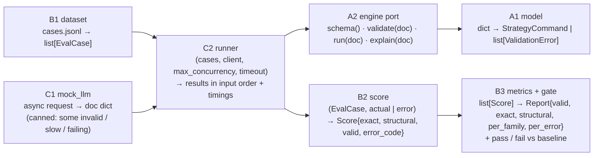

# fde-lab — plan (modules, I/O, what to learn, port to Dauphin)



| Module | Day | Learn in Python | C# twin | Ports to Dauphin as |
|---|---|---|---|---|
| A1 model | 1–2 | dict / list / tuple / set, Literal, Optional, Decimal vs float, pydantic models + field / model validators, custom exceptions | record, Dictionary<K,V>, pattern matching, validation + exception hierarchy | the policy rule grammar (when / then, readings) |
| A2 engine port | 3 | typing.Protocol, ABC, duck vs nominal typing, dependency inversion | interface + DI, contract tests | DauphinEngine adapter (C# validator via SignalCli) |
| B1 dataset | 4 | file I/O, json, generators (yield), frozen dataclass, comprehensions | IEnumerable + yield return, records, System.Text.Json | Tests/fixtures/nl_evals |
| B2 score | 5 | recursive dict / list diff, normalisation, order-insensitive lists, Counter, defaultdict | recursion, IEqualityComparer, HashSet semantics | the same scorer on real documents |
| B3 metrics + gate | 6 | grouping, sorting with key, statistics, pytest fixtures + parametrize | LINQ GroupBy / OrderBy, xUnit Theory | the NL regression gate in the test tiers |
| C1 mock_llm | 7 | async def, asyncio.sleep, closures, seeded random | async Task, Task.Delay, fakes | the real LLM client, same signature |
| C2 runner | 7–9 | event loop, create_task, gather vs TaskGroup, Semaphore, wait_for / timeout, CancelledError, exceptions in tasks, asyncio.Lock, perf_counter, deterministic tests | Task.WhenAll, SemaphoreSlim, CancellationToken, OperationCanceledException, lock / Interlocked, thread pool vs one loop | the same runner over DauphinEngine |

## Toy model (shaped like Dauphin's grid + rules, easy to port)
```text
StrategyCommand
  kind: "grid"
  symbol: str                  # "XAGUSD"
  side: "long" | "short"
  price_min < price_max: Decimal
  levels: int (2..200)
  lots_per_level: Decimal (> 0)
  rules: list[Rule]
Rule
  id: str
  when: {op: [reading, value]}   op: > < >= <=   reading: price | position | folio.drawdown | folio.weight
  then: list[Action]             {"hold": "increases"|"decreases"} | {"cap": lots} | {"setTarget": lots} | {"notify": text}
ValidationError {path, message, code}    e.g. path "rules[0].when", code "E_UNKNOWN_READING"
```

## Nine days
D1 model types + JSON in / out · D2 validators + error codes · D3 engine Protocol + ToyEngine + contract tests ·
D4 dataset loader + 20 cases · D5 scorer: exact + structural · D6 metrics + regression gate ·
D7 mock_llm + sequential runner · D8 bounded concurrency, timeouts, cancellation · D9 shared state, determinism, throughput numbers

Later: real LLM client with one repair retry · MCP server over the engine port · DauphinEngine adapter + Dauphin eval set (ported at the very end).