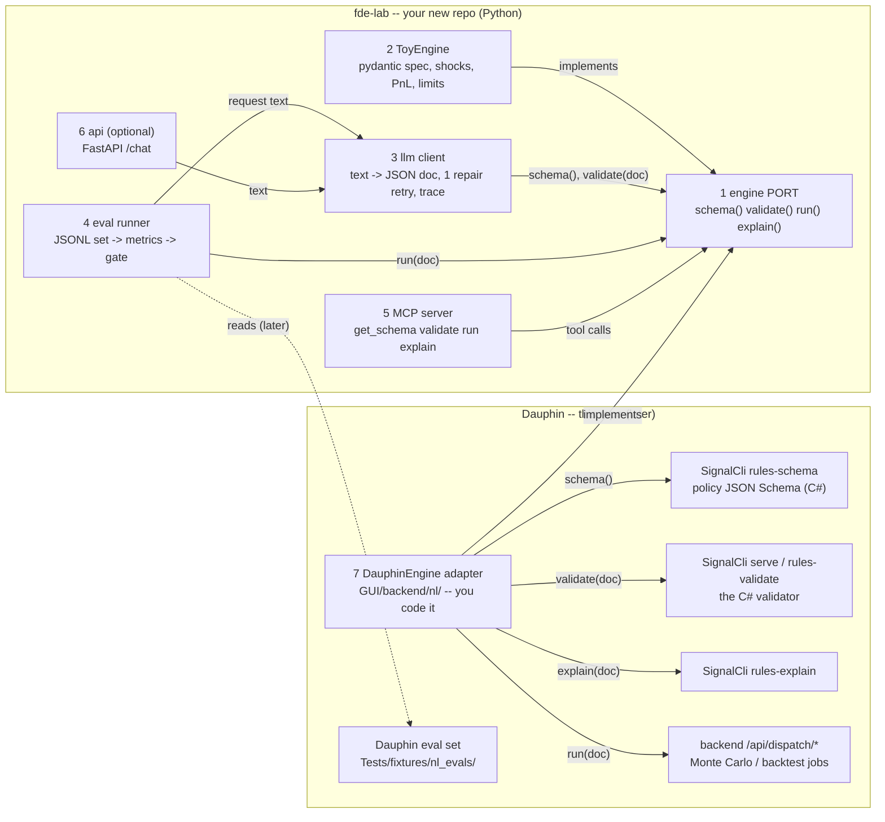

# FDE lab -- setup + architecture (your Python interview project, reusable in Dauphin later)

You write ALL the code. The lab's Claude session explains the theory and reviews your code AFTER it works -- it never
writes it. This chat (Dauphin) is not disturbed: the lab has its own repo, its own folder, its own session.

## 1. Where it lives -- a SEPARATE repo, outside the Dauphin tree (not a submodule)
- Create `C:\dev\fde-lab\` yourself (`git init`; a private GitHub repo, public when you want to show it). NOT under
  `C:\StrategyCreator\`: that folder holds prod (`secrets\`, `bridges\`, `envs\`, `data\`).
- Why separate: your demo can be shown (it never contains Dauphin's grammar); Dauphin's releases are never touched
  (release.ps1 refuses an untracked file); its own venv, pytest, history. Why not a submodule: a gitlink inside Dauphin's
  tree complicates the clean-tree release and the image build.
- Later, in DEV: Dauphin's venv installs your package (`.venv\Scripts\python -m pip install -e C:\dev\fde-lab`) after a
  dependency check (no version clash with the backend). In the IMAGE: a pinned, tagged version (a wheel), never a path
  outside the repo (image = code).
- This machine is prod: keep the lab light (no local model, no Docker, no endless loops; the LLM runs remotely).

## 2. The architecture -- your components and their arrows to Dauphin

## 3. Each component -- its job, input -> output (no spoilers: HOW is yours)
| # | Component | Job | Input -> Output | Done when |
|---|---|---|---|---|
| 1 | engine port (Protocol) | the ONE contract every engine follows | `schema() -> dict` (a JSON Schema); `validate(doc) -> {ok, errors: [{path, message, code?}]}`; `run(doc) -> result dict`; `explain(doc) -> str` | both engines pass the SAME contract tests |
| 2 | ToyEngine | a small scenario engine | a spec (portfolio + shocks + limits) -> P&L per scenario + limit breaches | ~200 lines, numbers hand-checked |
| 3 | llm client | plain language -> a valid document | text (+ engine.schema()) -> doc + trace {prompt_version, tokens, latency_ms, cost, repaired} | an invalid first answer is repaired once with the validator's errors |
| 4 | eval runner | measure how often 3 gets it right | JSONL rows {request, expected or "refuse", family, lang} -> {valid_rate, match_rate, exec_rate, refusal_rate, per_family} + pass / fail vs a baseline | a worse prompt fails the gate |
| 5 | MCP server | expose the engine to any AI client | MCP tool calls -> the port's answers (JSON) | Claude Desktop / Code calls your 4 tools |
| 6 | api (optional) | the chat page's backend | POST /chat {text} -> {doc, result, explanation, trace} | one request end to end |
| 7 | DauphinEngine (later, here) | the same port on Dauphin's C# | the port's calls -> Dauphin's commands (diagram) | 1 + 4 pass on Dauphin documents |

## 4. The integration contract -- what keeps it reusable (keep these from day one)
- Read the schema at RUNTIME from the engine (`schema()`); never copy a grammar into Python.
- Errors: accept `{path, message}` and an OPTIONAL `code` (Dauphin adds codes soon).
- Ids: Dauphin makes its own ids (C#); your code never generates a Dauphin id.
- Numbers come ONLY from the engine; the model explains numbers, never computes them.
- No network in unit tests (a fake LLM); evals deterministic for CI (recorded answers); secrets from env vars only.
- Dauphin's side (me, before step 7): stable error codes + paths in the validator's answers, a `schemaVersion` in the
  policy schema, a schema per document kind (folio, signal ...), ids made in C# -- all additive, your code keeps working.

## 5. How Dauphin will use it (later, on your go)
- Text or VOICE (speech -> text in the browser, then the same path: voice changes nothing in the port) -> component 3 ->
  a DRAFT document shown in the existing editor, validated by C#; only YOUR click saves it. The model never saves, never
  sends an order, never touches julien.
- Component 4 -> Dauphin's NL regression gate (its own eval set, FR / EN), run like the other test suites.
- Component 5 over DauphinEngine -> Claude Desktop / Code can read, validate, explain and run a Monte Carlo on SIM data.

## 6. Testing against Dauphin without touching it (read-only, at step 7)
The built tools (`Src/Tools/SignalCli/bin/Debug/net9.0/SignalCli.exe`): `rules-schema`, `rules-validate`, `rules-explain`
(their flags: `Src/Tools/SignalCli/RulesCommands.cs`) on the 13 example policies in `config/policies/` -- never tenant
data (C:\envs), never a live bridge.

## 7. Setup guide -- what goes where
1. YOU: create `C:\dev\fde-lab`, open a terminal there, `git init`, `py -3.12 -m venv .venv` (3.12 is installed here), then
   `.venv\Scripts\python -m pip install pydantic httpx pytest jsonschema "mcp[cli]" fastapi uvicorn` + your LLM provider's SDK.
2. Copy THIS file to `docs\SETUP.md` there, and create `CLAUDE.md` there with:
   > You are my tutor for this Python project. Never write, complete or fix my code. Explain theory, give one hint at a
   > time, ask me to write the test first, review my code only after it runs. The integration contract with Dauphin is
   > docs/SETUP.md section 4 -- point out anything I write that breaks it. Dauphin (C:\StrategyCreator) is another
   > project with its own session: never read, edit, build or run anything there.
3. Open a NEW Claude Code session on `C:\dev\fde-lab` (Code tab -> new session -> that folder). First message:
   > Read CLAUDE.md and docs/SETUP.md. I start with component 1 (the engine port) and 2 (ToyEngine), tests first.
4. THIS chat builds the main platform only. The integration (component 7, the Dauphin eval set, the eval GUI) comes at
   the VERY END of the Dauphin plan, by you, me reviewing; until then nothing of the lab enters this repo.
5. Start order: 1 + 2 (pure Python, no LLM) -> 4 on hand-written documents (no LLM yet) -> 3 (the LLM) -> 5 (MCP) -> 6 -> 7.
